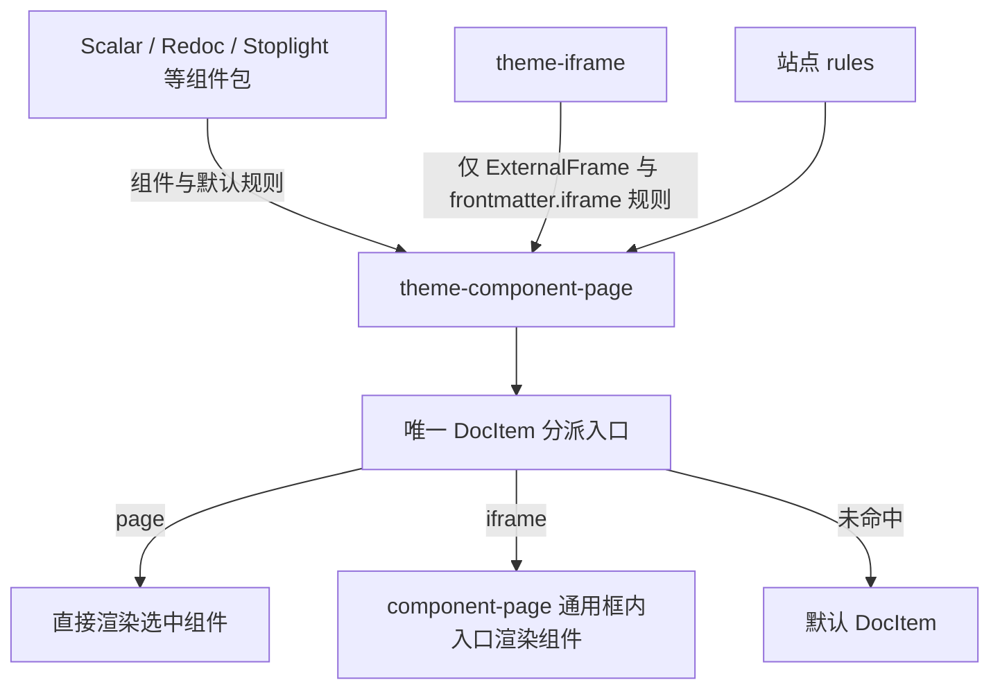

# 维护者文档：theme-component-page

这份写的是**改这个包之前要知道的事**：两张表怎么变成浏览器读得到的组件、各处判据住在哪一份里、
同源框那一侧的循环与数据边界，以及失败模式的落点。使用者那一面（选项、入参、写法）在
[README](../README.md)，那条跨文档通道的口径在 [`iframe-protocol.md`](./iframe-protocol.md)。

这一包是「这一页整页交给一个组件」这一族的**唯一分派器**：判键、合成规则表、`DocItem` 那个套壳、
`render: 'iframe'` 那个同源框与握手、框内那条路由、三条视图层共用的外壳都在这一份里。它不
import 任何主题包，也不认得 `oas3` / `aas3` / `markmap` 这些业务键名 —— 那些由各包自己在
`loadContent()` 里交回来。这一族的形状：



## 组成

| 文件                                         | 谁编译它               | 管什么                                                                                                                                                                |
| -------------------------------------------- | ---------------------- | --------------------------------------------------------------------------------------------------------------------------------------------------------------------- |
| `src/index.mts`                              | `tsc` → `dist/`        | 插件入口：查解析器插件那条安装前提（`loadContent`）、校验站点那两格、挂主题层、在 `allContentLoaded` 收集各插件交回的那一格、合成表、写两份生成模块、注册那条框内路由 |
| `src/config.mts`                             | `tsc` → `dist/`        | 组件登记表与规则表的校验与归一化（配置期，红在「加载配置」那一句）：四种臂、两种读法、两种落点、`props` 判到底、两组保留键名                                          |
| `src/contribute.mts`                         | `tsc` → `dist/`        | 别的插件交回那一条约定的读取，以及全站那一张最终表的合成（登记名去重、抢键红、站点那一列排前面、剩下的按键名固定字符串顺序追加）                                      |
| `src/registry-module.mts`                    | `tsc` → `dist/`        | 两份生成模块的**文本**（配置期，纯函数）：文档页那一份与框内那一份，按 `render` 分两侧                                                                                |
| `src/frame-route.ts`                         | `tsc` → `dist/`        | 那条通用框内路由的名字与地址算法（注册侧与请求侧共用同一份，所以常量必须住在 `src/`，见 `lib/frame-route.ts` 头上那句）                                               |
| `src/prerequisites.mts`                      | `tsc` → `dist/`        | 发给**交规则的层**那一条安装前提：要交规则得装上本层（出口 `./prerequisites`；样式表隔离那一条现在住在用它的那一层，见 `themes/theme-viewer/src/prerequisites.mts`）  |
| `lib/component-page.ts`                      | 用它的站点编（不编译） | 条目形状 + 命中判据 + 入参组装 + 落空与多命中告警；不引 React、不引 DOM                                                                                               |
| `lib/frame-messages.ts`                      | 用它的站点编（不编译） | 那四条跨文档消息的形状、`isFrame*` 那道门槛、送出去那份数据的 JSON 判据                                                                                               |
| `lib/frame-sync.tsx`                         | 用它的站点编（不编译） | 两侧的消息循环：外层 `useFrameHandshake`（握手 + 配色 + 接住框里报的那一段）、框内 `FrameBridgeProvider` / 那几条读状态的 hook                                        |
| `lib/frame-url.ts`                           | 用它的站点编（不编译） | 框内那份文档的地址（同源、跟着 `trailingSlash`、从不带查询参数）与一条外部地址在这一页上能不能用（只升不降）                                                          |
| `lib/frame-view.tsx`                         | 用它的站点编（不编译） | 框内那一页按需取渲染器那层壳（`useLazyView` / `LazyView`）：取之前只有一句话、取不到在框里摆一条看得见的说明                                                          |
| `lib/frontmatter-values.ts`                  | 用它的站点编（不编译） | 「一组键里这一页写了哪几把」那一份读法（各条 API 层自己传入 `oas3` / `aas3` 那一串，机制层不认得它们）                                                                |
| `lib/location-mirror.tsx`                    | 用它的站点编（不编译） | 把框内那份文档地址里 `#` 那一段报给外层那一格（Redoc / Elements 共用，`useLocation` 由各层自己交进来，不在这里选路由包）                                              |
| `lib/view-layer-shell.tsx`                   | 用它的站点编（不编译） | 「在正文上方多插一块视图」那三条层共用的外壳（错误边界 + 视图 → 分隔线 → 容器 + 宽度补丁）                                                                            |
| `lib/view-layer.ts` / `view-layer-labels.ts` | 用它的站点编（不编译） | 那句宽度补丁的文本与那一族提示文案的形状                                                                                                                              |
| `lib/isolate-renderer-css.ts`                | 用它的站点编（不编译） | 把某一份第三方静态样式表从「并进全站那一份 css」改成「单独一个产物」的那条 webpack 接线（`theme-scalar` / `theme-stoplight` 用）                                      |
| `types/component-page.d.ts`                  | 不产出（只有类型）     | 那两张表的形状：配置期校验它、浏览器期读它，两侧引同一份                                                                                                              |
| `types/component-page-specifiers.d.ts`       | 不产出（只有类型）     | 告诉 TS 那两份生成模块存在，并把它们的形状钉成上面那一份                                                                                                              |
| `theme/DocItem/index.tsx`                    | 用它的站点编（不编译） | 判表的那一格：命中 `page` 就挂组件，命中 `iframe` 就挂那个同源框，落空交回 `@theme-init/DocItem`                                                                      |
| `theme/ComponentFramePage/index.tsx`         | 用它的站点编（不编译） | 框内那一份独立文档：按登记名查组件、四种看得见的状态，不套站点 Layout、不再判一遍表                                                                                   |
| `components/component-frame.tsx` / `.css`    | 用它的站点编（不编译） | 外层文档里那一个 `<iframe>`：数据合法才挂、送不出的那一格在外层就挡下来给一句说明                                                                                     |

`src/` 编成 `dist/`，其余都是源码：与其余各包同一口径（谁编译、为什么不编译，记在仓库根
`README.md` 那张表里）。覆盖率红线因此是 `src/` 那六份 + `lib/` 那十二份
（`vitest.config.mts` 的 `coverage.include`），`theme/` 与 `components/` 那两层只有开页面才看得见，
由 e2e 钉。

## 「配置 → 组件」这一跳为什么要生成两份文件

`@theme/*` 是 webpack 的**构建期**别名（`@docusaurus/core/lib/webpack/aliases/index.js`：
按层栈扫目录，一格一个精确 specifier），磁盘上没有 `@theme` 那个目录。浏览器侧那份 `DocItem`
因此只能写死 `import`，没法 `import(变量)` —— 配置里那串字符串到不了运行时。

这一包的解法是配置期把字符串**铺成源码**：`src/registry-module.mts` 按 `render` 出两份带静态
`import` 的模块文本，`allContentLoaded` 把它们写到

```
<generatedFilesDir>/theme-component-page/registry.ts
<generatedFilesDir>/theme-component-page/frame-registry.ts
```

浏览器侧用 `@generated/theme-component-page/registry` 与 `…/frame-registry` 读它们。分两份是为了
那一串 MB 的渲染器不进出口的 chunk：文档页那一份只 `import` `render: 'page'` 那侧引用到的组件
（`render: 'iframe'` 那几条仍占一行，但不带 `Component`），框内那一份反过来只收 iframe 那侧、
按登记名去重。三条根据都按**符号**认，不按行号认（行号随 Docusaurus 版本漂），读的是
`@docusaurus/core/lib/webpack/base.js`：

- `resolve.alias` 里有 `'@generated': generatedFilesDir` —— 那条别名就是生成目录本身；
- `resolve.extensions` 收了 `.mjs` / `.js` / `.jsx` / `.ts` / `.tsx` —— 所以生成文件不用写扩展名；
- 官方那条 JS 规则 `{ test: /\.[jt]sx?$/i, exclude: excludeJS }` 里，`excludeJS()` 只对路径含
  `node_modules` 的那一路交回 `true`（docusaurus 自己的包除外）—— 生成目录不含它，
  所以 `.docusaurus/` 里的 `.ts` 照样进 babel。

这三条一升级就该重读一遍；运行时替身是 e2e 那条「命中那把键的页整页交给组件」——
它读不到生成模块就红，比这里任何一句描述都诚实。

写这一步放在 `allContentLoaded`，不放在入口调用，也不放在 `loadContent` / `contentLoaded`：
`generatedFilesDir` 要到插件装载完才存在，而客户端打包在这之后才开始；更要紧的是
`allContentLoaded` 是**唯一**「所有插件的 content 都已到齐」的点 —— 每个插件的
`contentLoaded` 紧接在自己的 `loadContent` 之后跑，别人的规则可能还没交回。入口调用那一步还会
被解析器的 `PluginDiscovery` 再跑一次，写盘会删掉自己的产物。同一步里 `actions.addRoute` 注册
框内那条路由也是这个原因：那是官方唯一允许跨插件调 `addRoute` 的时机。

单插件重载也会重跑所有插件的 `allContentLoaded`，重新汇聚和写注册表；每一轮都从完整的
`allContent` 全量重算并整份覆写，所以没有「这一轮只看到一部分包就先把表铺出去」的中间状态，
删掉最后一条规则也照样出两份合法的空表。规则输入若要触发这一通道，应由贡献方通过
`getPathsToWatch` 声明；未被监听的输入修改需要重启 dev server。这份生成文件本身不需要
`getPathsToWatch`（它是产物，不是输入）。

**代价**：生成文件的形状与 `types/component-page-specifiers.d.ts` 那份声明之间没有编译器拦着
（那份声明就是 TS 看到的唯一真相，磁盘上那份文件在类型检查时还不存在，而 `.docusaurus/` 本身
排在 `tsconfig.json` 的 exclude 里）。同理，入口写盘那两路径与浏览器侧那两句 `@generated/…`
是两处字面量。所以这些对齐各由一条测试钉住（都在 `test/component-page-registry.test.mts`）：
铺出来的每一格键名 = 两份声明里的格集合，那两句说明符反推的路径 = 入口真的落盘那两路路径，
运行时那一半由 e2e 钉。**新增一格要走的全程**：`types/component-page.d.ts` 的形状、
`src/registry-module.mts` 的文本、`theme/DocItem` 或 `theme/ComponentFramePage` 里读它的那一格、
上面那两条对齐的期望集合 —— 漏了任何一处，前两条会红；只漏最后一处，才轮到静默拿到
`undefined`。

## 判据住在哪一份

- **命中判据、入参组装、告警**：`lib/component-page.ts`。配置期与浏览器期引同一份，于是
  `match` 那四种判法只写一次。判据读的是 `ComponentPageFacts` 那两份事实（`frontMatter` 与 MDX
  模块 `content`）：同名键先看 frontmatter，那里没有才看模块上的命名导出，**没有回落**；
  `theme/DocItem` 只负责把这两份传给 `matchComponentPage()`，自己不看键。loader 追加的
  `export const`（`theme-erd` 的 `dbml_json`）就是从第二条进判据的。
  入参的次序在同一份里的 `componentPageProps()`：配置里 `props` 那格垫底，本页那三份盖在上面，
  **同名的键以那三份为准**（那一格是每一页共用的入参，不该盖掉本页的事实）。iframe 那一侧同一条
  语义在 `lib/frame-messages.ts` 的 `frameInitPayload()` 里再定一次 —— 两处都不许改，改了
  `test/component-page-entries.test.mts` 与 `test/frame-messages.test.mts` 各会红。
- **校验**（什么形状的配置算写歪）：`src/config.mts`。`key` 那一格先挡官方文档页 frontmatter 的
  那一组键名（`RESERVED_FRONTMATTER_KEYS`）：本层判的是「这一页写了这把键」，而官方那一组
  几乎每一页都写着，拿它当键就是把整站正文换成一个组件 —— 整组红，不看判法是哪一种。
  那份名单是**从装的这个 Docusaurus 里抄来的**，所以由一条测试对回原处
  （`test/component-page-config.test.mts` 读 `@docusaurus/plugin-content-docs/lib/frontMatter.js`
  的 `DocFrontMatterSchema.describe().keys`）：升级后官方多一把键名，那条先红。
  同一格还挡 Docusaurus 给每份 MDX 模块注入的那五个导出名（`RESERVED_EXPORT_KEYS`：
  `frontMatter` / `contentTitle` / `toc` / `metadata` / `assets`）—— 判据也读模块上的同名导出，
  这五个几乎每一页都有，按 `match: 'any'` 判就是每一页都命中。
  `props` 那一格判到底（`assertPureData()`）：串 / 数 / 布尔 / `null` / 普通对象 / 数组以外的
  一切都红在配置加载那一句，消息点名到 `rules[0].props.filters[1].on` 那种完整路径。理由是本仓
  那两份产物走 JSON 写法，iframe 那一侧还要再跨一次 postMessage：函数与 `undefined` 会静默消失、
  `NaN` 写成 `null`、`Date` 与 `Set` 变成另一种东西。循环引用也在这一步拦（`parents` 那一条
  来路），否则抛在 `JSON.stringify` 里、看不出是哪一格。
- **优先级**：`src/contribute.mts` 的 `buildRuleTable()`。站点那一列排前面（那一列里写的顺序就是
  命中优先级），没被它提过的默认规则按**键名的固定字符串顺序**接在后面 —— 不读 `plugins` 的声明
  顺序，也不读 `allContent` 的键序：那条顺序由官方的聚合实现给，不是它对外的承诺。同一站点多装
  一个包、把两项调个位，都不该改变两页之间的先后。浏览器侧只按数组顺序从头走到第一个命中，
  所以「表怎么排」这件事只有这一处答案。

## 条目还有第二个来源：装了的插件自己交回

站点那两格之外，`src/contribute.mts` 认一条约定：**插件的 `loadContent()` 交回的 content 里有
`componentPage` 这一格**，那一格里就是那个插件要交出的组件与默认规则。这一格不新造发现机制，
走的是官方那条 `loadContent` → `allContent` → `allContentLoaded`：官方把所有插件的 content 按
「插件名 → id」汇进 `allContent`，本层在 `allContentLoaded` 里遍历它。

四件事值得在改它之前知道：

- **判据就是 content 上有没有那一格**，不看包名清单、不读 `themeConfig`、不要求实例上有哪个
  方法，也不扫描站点装了哪些包。没有这一格 = 这个插件不交；有但形状写歪，红并把插件名带进列名。
  同一个包装了两次（不同 `id`）就是两份 content，报错与提示里带上 `id` 才分得清。
- **来源 = 所有被装载的插件**：preset 展开的、相对路径入口的、配置里直接写函数的都会走到
  这一步。边界有一条：装在依赖里但没注册进 `plugins` / `themes` 的包不会出现（旧方案里
  `contributors` 能点名这种包，这一版没有对应物）。
- **合成只有那几条**（站点排前面 / 一条字符串是把某条默认规则**提到这个位置**、内容照取不算覆写 /
  站点也写这把键就用站点的并留一条提示 / `{ key, enabled: false }` 让这把键谁交来都不生效 /
  两个包抢同一把键或同一个登记名直接红）。抢键那条选红不选「先到先得」：两个包各写各的，
  谁赢都没有合理依据，而让一个悄悄赢的话，另一个包自己的键照样命中、页面却归了别人 ——
  那种结果从产物里看不出来。站点关掉那把键时它让位：两边都不再生效，红不红已经没有后果，
  而「红」反倒会让站点没法收拾一个它自己改不了的冲突（键名住在那两个包里）。
- **两条臂各守各的写法**：`normalizeSiteRules()` 认三种臂（字符串引用 / 完整规则 / 禁用），
  `normalizeContributedRules()` 只认真规则。包交出的那一条写了 `enabled` 当场点名 —— 安静忽略的
  症状是「那个包以为自己把键关了，实际那条照常生效」。完整覆写**不继承**默认规则的
  `match` / `source` / `render` / `props`：只改一格的写法看着像调一下，实际把另几格换成了缺省值。

上一版那一格（`componentPages`，一列「键 → 说明符」）与上一版那个插件选项（`pages`）都只用来
**红一次**（`legacyContributionError()` 与 `assertNoLegacyPages()`），并把迁移的话说清楚。让它们
安静地不生效是最坏的那种升级：站点照常构建，框、导图、关系图从每一页上消失，看不出跟这次升级
有关系。

钉这一格的是 `test/component-page-contrib.test.mts`：单元对合（认法、报错点名的列名、多 id、
那几条合成规则、抢键与关掉、一个包多组规则）+ 一条端到端（夹具站点里真装一个交出条目的包，跑
**真的** `loadContext` + `loadPluginConfigs`，再照 core 的口径把各插件 `loadContent()` 的结果收进
`allContent`，要求合成结果与顺序真的落进那两份生成文件，并证明没装本包的站点里贡献方照样装载）。

## `render: 'iframe'` 那一侧

一条规则写 `render: 'iframe'` 之后发生的事，全部在本层里，不需要别的包参与：

1. `theme/DocItem` 判到它，命中就换成 `components/component-frame` 那一格 —— 父文档**不 import**
   那个组件，只把登记名与本页那几份数据准备好。
2. 那一格算出框的地址：`lib/frame-url.ts` 的 `frameRouteUrl()` 按站点的 `baseUrl` 与
   `trailingSlash` 拼那条同源路由。**地址里不带任何本页的信息**（没有 `?src=`，也没有本页路径），
   所以服务端渲染与客户端水合算出同一个字符串 —— 两边不一样就会先加载错的再由 React 改回来，
   中间那一次加载是白撞。尾斜杠也不能省：`trailingSlash` 没配时产物是 `__component-frame/index.html`，
   少一个斜杠要先吃部署侧那条「补斜杠」的 301，而那条 301 的协议跟着部署侧走。
3. 数据先在外层过一道 JSON 判据（`frameDataError()`）。送不出的一格在外层就摆一条看得见的说明，
   不等浏览器在 `postMessage` 那一步抛 —— 那种抛发生在另一份文档里，报错点隔着一整个页面。
4. `lib/frame-sync.tsx` 的 `useFrameHandshake()` 跑那条循环：装好监听器先推一次、框报 `ready`
   再推一次、外层切亮暗再推一次、框里换地址报回来的只走 `replaceState`。两侧各推一次是必须的
   —— 命中缓存时框里那份文档可能比外层的水合还快，只由外层在 `load` 事件上推会丢首帧（这条
   踩过，记在 [`iframe-protocol.md`](./iframe-protocol.md)）。
5. 框里那份文档（`theme/ComponentFramePage`）按登记名查 `@generated/theme-component-page/frame-registry`，
   查到就用 `payload.data` 当入参渲染那个组件。四种状态各有各的话：没等到数据、登记名查不到、
   组件自己抛出来、渲染器还在下载（最后那一格归组件自己，各层用 `lib/frame-view.tsx` 的
   `LazyView`）。

三条边界：**同源**（那条路由是本层注册的，所以这套约定不需要跨源信任；每条消息仍过
`isTrustedMessage()`，为的是别人往这一页 postMessage 时不被当成自家的）；**不是安全沙箱**
（框里跑的还是本仓编译出来的组件，这一格隔的是 DOM、样式表、localStorage 与路由）；
**不是通用 RPC**（只有那四条消息，没有请求—应答式的第三格）。

框内那份文档不套 `@theme/Layout`，也不判那张表：外层已经判完并把结果送进来了，再判一次就有
两个分派器，两边的顺序迟早会漂。它也不从站点读亮暗 —— 那条 `data-theme` 在这份文档里只是内联
脚本写死的一份、没人维护，所以亮暗由外层随消息送进来。

## 与 `theme-iframe` 的边界

`theme-iframe` 收缩成只剩 `iframe:` 那一把键：嵌**别人站点**的一个 URL。它交回组件
`@theme/ExternalFrame`（`source: 'frontMatter'`、`match: 'value'`、`render` 用缺省的 `page`）
和自己的那份框，跨源那一份地址算法留在它自己包里（`/` 打头补 origin、`?path=` 再解一层、
https 页面上把 `http:` 升上来）。它不再提供 `DocItem`、不提供通用框页、不提供注册工厂，
`lib/` 里只剩 `external-url.ts` 那一份判据。

于是这一族的验收是：**卸载 `theme-iframe` 只影响 URL 嵌入，三条 API 层与它们的同源框照常可用**。
这一条已实测过：临时把 theme-iframe 挪出站点配置重建，三条 API 页照常出框、
`/__component-frame` 照常产出，相关五份 e2e 全过。
本层不 import 它，那条路由与本层那张表都不经过它（e2e 里 `frame-precedence.feature` 与
`iframe.feature` 各钉一头）。

三条 API 层（`theme-scalar` / `theme-redoc` / `theme-stoplight`）各交一对：一个组件（指向自己
`theme/` 里那份**框内**视图 `@theme/ScalarView` / `@theme/RedocView` / `@theme/StoplightView`）
和一条 `{ key, match: 'boolean', render: 'iframe' }` 的规则；要渲染哪份文档读它们自己的那两把
spec 键（`oas3:` / `aas3:`），键名由它们自己传给 `lib/frontmatter-values.ts`，机制层不认得。

`theme-markmap`、`theme-erd` 与 `theme-diff` 是另外三个交出方，走的还是同一条约定：各交回
`{ key: 'markmap', match: 'options', component: 'markmap' }`、
`{ key: 'dbml_json', match: 'any', component: 'erd' }` 与
`{ key: 'diff', match: 'any', component: 'diff' }`，组件指回自己的 `@theme/MarkmapPage` /
`@theme/ErdPage` / `@theme/DiffPage`。`markmap` 是「开着、选项写在键里」，由 `options` 判法原样
交给它自己的页面组件；`dbml_json` 那把键**不写在 frontmatter 里** —— 它是 `theme-erd` 的 loader
给 `.dbml` 页追加的 `export const`，判据读模块导出那一处才命中；`diff` 那把键三种写法各有含义
（`true` 比本文自己、路径比那一份、`{ old, new }` 比磁盘上那两份），所以用 `any`。那三条都是
`render: 'page'`：它们在正文上方多插一块视图，要留正文，所以用不了 iframe 那一侧。

本包在 `src/index.mts` 里只跑**一条**前置检查：解析器插件在不在那两份清单里，走的是那个包自己
发出来的 `assertPrevLayerResolverInstalled()`（`@show-docs/docusaurus-plugin-prev-layer-resolver/plugin-slots`）。
它**不**引 `theme-iframe`：本层是通用机制，站点不装它也用得上。别的层需要的另一条（要交规则得装
本层）在本包的 `./prerequisites` 出口里，由**真把规则交出来**的那几层的入口调用；不交规则的层
（`themes/` 那一族）直接引解析器那一句就够，不为本包的一条纯函数多背一条依赖 —— 同一条理由当年
把这句检查从 `theme-iframe` 搬进了解析器包（见那里 `src/plugin-slots.mts` 的头上）。

本站把本层声明在其余各层**之后**，所以它在层栈最外、最先判（越晚声明 = 层栈越靠外 = 越先判，
那条口径记在[解析器插件的 README](../../plugin-prev-layer-resolver/README.md)里）；换个位置放就
换个先后，机制本身不管这件事。**这条顺序只管「这一页归谁判」，不管那张表里的优先级** ——
后者只看站点那一列与键名。

**在最外那一格因此遮住下面各层的 `DocItem`**：一页同时写中本层的键和下面某一层覆盖的
`DocItem` 时，本层命中就不再往下走，那一层根本不会被走到、它的告警也不会打（站点自己覆盖
`src/theme/DocItem` 时就是这一类）。两层互不认识，谁也报不了这条冲突，所以顺序是站点作者的判据。
上面那七把键不再有这个问题 —— 它们本来就在本层这张表里，一页只交出一个组件（排在前面的那条赢，
所以一页同时写了 `markmap:` 与 `scalar:` 时也只挂其中一个，dev 模式另有一条告警点名其余那几条）。

这里的「下层」是 `@theme-init/DocItem`：仓库里只有本层提供 `DocItem`，未命中时交回官方那一份，
不会自动串联第三方中间层。页面组件若需要保留正文、`DocProvider` 或元信息，应自己显式组合
`@theme-init/DocItem`（写成 `render: 'page'` 并在组件里挂正文），不要在这里留第二条通道。
docs 路由自定义了 `docItemComponent`，或站点 `src/theme/DocItem` 覆写了分派器时，自注册贡献
也可能不被使用。

## 失败模式与落点

| 症状                                                                          | 落点                                                                              |
| ----------------------------------------------------------------------------- | --------------------------------------------------------------------------------- |
| 两格形状写歪                                                                  | 配置加载那一步红，消息带 `rules[下标].哪一格` / `components[下标].哪一格`         |
| `key` 用了官方文档页 frontmatter 的那一把键名                                 | 配置加载那一步红，点名那一格与该键名                                              |
| `key` 用了 Docusaurus 注入的那五个模块导出名                                  | 同上（`RESERVED_EXPORT_KEYS` 那一条）                                             |
| 同一列里同一把键（引用、覆写、禁用混着写）或同一个登记名出现两次              | 同上（`once()` / `seen` 那一条）                                                  |
| `match` / `source` / `render` 写了名单以外的东西                              | 同上（`normalizeEnum()` 那一条，消息列出它认的名单）                              |
| `props` 深处不是纯数据（函数、`undefined`、`NaN`、`Date`、循环引用）          | 配置加载那一步红，消息带完整路径 `rules[0].props.a.b`                             |
| `components` 里的 `component` 写成 `@theme/DocItem`                           | 配置加载那一步红：那个别名归本层，注册表会 import 回自己                          |
| 说明符指到别名表认不出的地方                                                  | 打包那一步 `Module not found`；生成文件里那条 `import` 上面有出处                 |
| 键写了但形状不合那条的判法                                                    | dev 控制台一条告警，页面交回普通文档页                                            |
| 一页同时命中几条                                                              | dev 控制台一条告警，只用排在最前那条并点名其余                                    |
| 装了本层却两格都没写、也没有包交条目                                          | 静默：生成两份合法的空表，每一页都原样交回官方那一份（这是合法配置）              |
| 某个插件交回的 `componentPage` 写歪                                           | `allContentLoaded` 那一步红，消息带 `componentPage（插件名 交出的）[下标].哪一格` |
| 插件交回的那一列写了 `enabled`                                                | 同上那一步红：关掉一把键只有站点那一列写得算                                      |
| 两个包交出同一把键 / 同一个登记名                                             | 同上，把抢的两边都点出来                                                          |
| 站点与某个包写了同一把键                                                      | 用站点那条（整条重写），构建日志一条提示（点名那个包）                            |
| 站点把某一格写成 `{ key, enabled: false }`                                    | 那把键整体不生效（包交出的也丢），构建日志一条提示；不进生成模块                  |
| 抢键的那两把正好被站点关掉                                                    | 不红：两边都不生效，各留一条提示                                                  |
| 站点引用了一把没人交出的键 / 一条规则引用了没人登记过的组件                   | `allContentLoaded` 那一步红，并说明那一格该写登记名而不是说明符                   |
| 某个包的 content 还写着旧的那格 `componentPages`，或站点还写旧的 `pages` 选项 | 那一步红一次，消息把迁移到 `componentPage: { components, rules }` 的话说清楚      |
| 框里那份数据的某一格送不出去（某一页的 frontmatter 写了函数以外的东西）       | 外层不挂框，摆一条点名到那一格的说明；配置期能查的那一半早就红了                  |
| 外层与框内不是同一轮构建（登记名查不到）                                      | 框里一条看得见的错误并点名那个登记名，不是空白                                    |
| 解析器插件没注册（缺 `@theme-*` 那组别名与那条 babel 规则）                   | 配置加载那一步红，点名那个包与 `pnpm add`；不再等打包报 `Module not found`        |
