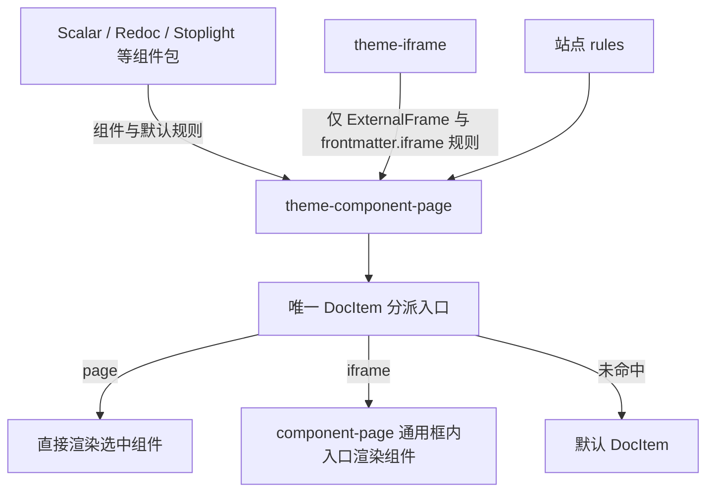

# 设计方案：组件自注册，component-page 统一分派

> 日期：2026-10-30。状态：待实施，允许破坏性调整。
> 当前实现见 [internals](./internals.md)；[v2](./proposal-v2.md) 和
> [API 层旧方案](../../theme-iframe/docs/proposal-api-self-register.md) 仅保留迁移背景。

## 核心设计

Scalar、Redoc、Stoplight 直接通过 theme-component-page 体系注册实际组件和默认规则。
theme-component-page 统一负责发现、规则匹配、直接渲染、同源 iframe 渲染及相关公共代码。
theme-iframe 收缩为普通组件包，只支持 `frontmatter.iframe` 指定的页面地址。

两种 iframe 用途明确分开：

| 用途                       | 配置含义                                   | 谁负责                             |
| -------------------------- | ------------------------------------------ | ---------------------------------- |
| 自注册组件在独立文档中运行 | 规则 `render: 'iframe'`，例如 scalar: true | component-page 的内置渲染能力      |
| 嵌入给定 URL               | frontmatter.iframe 是非空字符串            | theme-iframe 的 ExternalFrame 组件 |

卸载 theme-iframe 只影响 URL 嵌入，Scalar/Redoc/Stoplight 及其同源 iframe 渲染照常可用。
不新增公共包，不保留业务注册中心；原来放在 theme-iframe 的公共能力迁到 component-page。



component-page 不依赖具体组件包。各组件包依赖 component-page 的契约与按需使用的公共能力；
Scalar/Redoc/Stoplight 不再 import、peerDepend 或检查 theme-iframe 是否安装。
theme-iframe 不提供 DocItem、不注册通用框内路由、不提供注册工厂或公共库。

## 最小自注册契约

使用 Docusaurus `loadContent → allContent → allContentLoaded` 的构建期数据通道，
不重新实例化插件，也不使用浏览器全局可变注册表。统一贡献字段为 `componentPage`：

```ts
type ComponentRegistration = {
  id: string;
  component: string; // 默认导出 React 组件的模块说明符，推荐 @theme/X
};

type Rule = {
  key: string;
  component: string; // 已注册组件 id，不是模块路径
  match?: 'boolean' | 'value' | 'options' | 'any'; // 默认 boolean
  source?: 'auto' | 'frontMatter'; // 默认 auto
  render?: 'page' | 'iframe'; // 默认 page，两种方式均内置于 component-page
  props?: Record<string, JsonValue>;
};

type ComponentPageContribution = {
  components?: readonly ComponentRegistration[];
  rules?: readonly Rule[];
};
```

`JsonValue` 指 JSON 可无损表示的有限数、字符串、布尔、null、数组与普通对象。
组件和规则分开注册：一个组件可以对应多条规则，一个包可以提供多个组件，组件也可以不提供默认规则。
组件 id 全站唯一，建议使用 `包名/组件名`，以下短 id 仅便于阅读；规则 key 是页面信号名。
站点 swizzle 对应 `@theme/X` 可以替换实现，改规则可以替换组件或执行环境。

```ts
// theme-scalar 的拟议 loadContent 返回值
const contribution = {
  componentPage: {
    components: [{ id: 'scalar', component: '@theme/ScalarView' }],
    rules: [{ key: 'scalar', component: 'scalar', render: 'iframe' }]
  }
};
```

Redoc、Stoplight 使用相同契约，各交自己的组件与规则，不再由 iframe 工厂代交。
组件自行解释 `frontMatter.oas3` / `aas3`、显示缺参或加载错误，并连接实际渲染器。
公共机制不认识这些业务键，不通过 namespace 查询中心表。

只认 content 的自有 `componentPage` 字段：缺席即不贡献，出现就必须合法。插件名、实例 id、
数组下标保留到错误和生成注释。未注册插件不贡献；`translateContent` 必须透传该字段；
规则输入的监听由贡献方 `getPathsToWatch` 声明，未被监听的修改需要重启 dev server。

## 一份站点规则配置

旧 `pages`、单独的 `order`、`themeConfig.apiFrame.order` 统一为 component-page 的 `rules`：

```ts
const siteOptions = {
  rules: [
    'scalar', // 引用默认规则并提升优先级，不复制内容
    { key: 'report', component: 'report', match: 'options' },
    { key: 'redoc', component: 'redoc', render: 'page' }, // 完整覆写
    { key: 'stoplight', enabled: false } // 禁用规则，组件仍然注册
  ]
};
```

最终表只有一套算法：

1. 校验所有贡献。重复组件 id、重复默认规则 key 均报错并列出来源；站点不掩盖冲突。
2. 按站点 rules 顺序展开引用、完整覆写和禁用；处理过的 key 不再追加默认规则。
3. 剩余默认规则按 key 的固定字符串顺序追加，不依赖插件声明顺序、allContent 枚举或异步完成顺序。
4. 一页多条命中时选第一条，dev 提示全部命中键和赢家；有业务要求的先后应在站点显式列出。

引用未知 key、站点列表重复 key、未知组件或渲染方式均在构建期失败。完整覆写不继承默认规则
的 match/source/render/props；禁用只删除规则，不卸载组件包。多实例须使用不同的组件 id 和规则 key。

四种匹配保持现有语义：boolean 认 true；value 认非空字符串；options 认 true 或普通选项对象；
any 认上述三类值。auto 先读 frontmatter 自有键，缺席才读 MDX 模块自有导出，显式 false 不回退。
frontMatter 只读 frontmatter，忽略同名模块导出。保留官方 frontmatter 和 MDX 注入键的保留名单。

## component-page 内置两种渲染

不提供 renderers 注册接口，page 和 iframe 都是 component-page 自身能力：

- page：在当前文档渲染选中组件，可使用父页面上下文，并额外收到 MDX `content`。
- iframe：创建同源独立文档，在通用框内入口渲染选中组件，不传 React content 或父页 context。

两种方式向业务组件提供 `{ ...规则 props, value, frontMatter }`，本页 value/frontMatter 覆盖
静态同名字段。iframe 的数据必须是 JSON；遇到不可传递的数据明确报错，不静默删字段。
需要正文、useDoc 或父页 DOM 的组件使用 page。更改 render 不会消除组件自身对环境的依赖。
依赖 DOM 的实际渲染器由组件自身延迟到浏览器执行。

分别生成 page 侧与框内侧的组件模块，只导入各自有效规则引用的组件。iframe 外壳只接收 id 和
数据，不在父文档 import 框内业务组件；同一组件被两种规则引用时，才允许两侧分别导入。

通用框内路由由 component-page 注册，拟为 `<baseUrl>/__component-frame`，替代各 API 包的
`/xxx-view`。框内按组件 id 渲染，不执行文档规则、不套站点 Layout、不再次创建分派器。
保留 Docusaurus 必要启动环境，业务样式和副作用在独立文档运行；同源 iframe 不是恶意代码安全沙箱。

握手仅支持必要的数据与同步：父级先安装监听器再加载 iframe；子级发送 ready 后，父级验证
精确 origin 和 event.source，并向精确 targetOrigin 发送 `{ componentId, value, frontMatter, props }`。
框内验证 id 与数据，父页变化发送完整快照，框重载则重新握手。SSR 与客户端首次渲染都显示稳定占位，
未初始化、非法数据、加载中和组件错误要有可见状态。

通用亮暗/hash 同步也由 component-page 提供：框内 hook 向组件提供颜色模式和报告 hash 的能力，
组件自行接到渲染器；消息检查来源，hash 做相等判断防回声，卸载清理监听。不扩展为通用 RPC。

## theme-iframe 只处理 frontmatter.iframe

该包只贡献一个组件和一条默认规则：

```ts
const contribution = {
  componentPage: {
    components: [{ id: 'external-frame', component: '@theme/ExternalFrame' }],
    rules: [
      {
        key: 'iframe',
        source: 'frontMatter',
        match: 'value',
        component: 'external-frame',
        render: 'page'
      }
    ]
  }
};
```

例如 `iframe: https://example.com/docs` 命中后，ExternalFrame 直接创建指向该 URL 的 iframe。
同名 MDX 导出不会触发这条规则。该包不接受 API 组件注册、不根据 URL 猜测渲染器，不读取
scalar/redoc/stoplight/oas3/aas3，也不把外站地址送进通用框内路由。

默认使用 page，是因为 ExternalFrame 自己已经创建 iframe，无需再嵌套内部 iframe。
站点可以排序、禁用这条规则或用其他组件完整替换；无需为此外加一套渲染器扩展接口。
URL 协议校验、title 与加载状态由 ExternalFrame 负责；浏览器无法可靠探测所有跨源 HTTP
加载失败，不能承诺读取外站状态。外站不需要实现内部握手或主题/hash 协议。

## 公共代码统一迁到 component-page

| 现有 theme-iframe 内容                                  | 迁移后                                                     |
| ------------------------------------------------------- | ---------------------------------------------------------- |
| 通用 iframe 外壳、握手、主题/hash 同步、框内运行时      | component-page 的 frame 公共模块与主题组件                 |
| view-layer-shell、view-layer、view-layer-labels         | component-page 的 view 公共模块，Markmap/Erd/Diff 直接引用 |
| isolate-renderer-css 等通用构建工具                     | component-page 的构建期独立导出入口                        |
| createApiFrameView 的加载与同步能力                     | component-page 通用辅助函数，不再接受中心表 namespace      |
| createApiFrameTheme、api-frame-registry、namespace 查表 | 删除；各 API 包直接贡献组件和规则                          |
| spec 键解释、实际渲染器与模式适配                       | 对应 API 包；稳定重复的纯函数按需提取到 component-page     |
| 外站 URL 嵌入组件及规则                                 | 仅留在 theme-iframe                                        |

不新增 common 包，也不保留 theme-iframe 的公共导出转发层。Node 构建工具与浏览器运行时
使用不同出口；公共库只接受参数，不维护业务组件名单。所有旧调用方同时更新 import、
dependencies/peerDependencies、exports 和安装前提。协议文档随公共运行时迁到 component-page。

## 页面边界与生命周期

文档页只保留 component-page 的一个 DocItem 分派入口。未命中时原 props 交给
`@theme-init/DocItem`；命中时替换整个 DocItem，正文布局、目录和翻页不自动保留。
需要正文的 page 组件显式组合默认 DocItem，不能重新调用分派器。

页面元信息由公共外壳保留：实施时复用 DocProvider 与 Metadata 组合，检查 Markmap/Erd/Diff
已有组合，避免重复 Provider、Metadata 或正文，不复制整个 DocItem 布局。框内不继承父 Provider。
站点自定义 docItemComponent 或覆写 src/theme/DocItem 时须自行接入分派器。

component-page 在 allContentLoaded 用完整 allContent 统一校验、合并、生成两侧映射，
并通过 actions.addRoute 注册通用框内入口，不依赖其他插件同阶段副作用。每轮全量重算，
内容未变不写盘，删除最后一条规则也生成合法空表。错误和生成注释保留来源即可，
不额外增加诊断 manifest、业务中心表或运行时可变注册中心。

## 一次迁移与验收

1. component-page 实现注册契约、统一 rules 和内置 page/iframe 渲染，接收公共库与协议文档。
2. Scalar/Redoc/Stoplight 改为直接注册，移除 theme-iframe 的全部依赖、工厂与安装检查。
3. Markmap/Erd/Diff 更新注册与公共代码 import；theme-iframe 删除公共能力，仅留下 URL 嵌入。
4. 更新站点、各包 README/internals、包导出、依赖和测试；旧贡献字段与已知旧配置明确报迁移错误。

至少验证：真实插件加载下的多组件注册、id/key 冲突、规则排序/覆写/禁用、page/iframe 渲染，
卸载 theme-iframe 后 API 组件及其 iframe 模式仍可使用；frontmatter.iframe 能嵌入 URL，
同名模块导出不触发；内部业务代码不在父文档执行；握手更新与重载、主题/hash、元信息与正文、
空表及 SSR/hydration 一致；各组件包源码与依赖声明均不再引用 theme-iframe 的旧公共模块。

本文仅调整设计，未修改运行时代码。实施后运行相关单测、`pnpm verify` 和 `pnpm test:e2e`。
